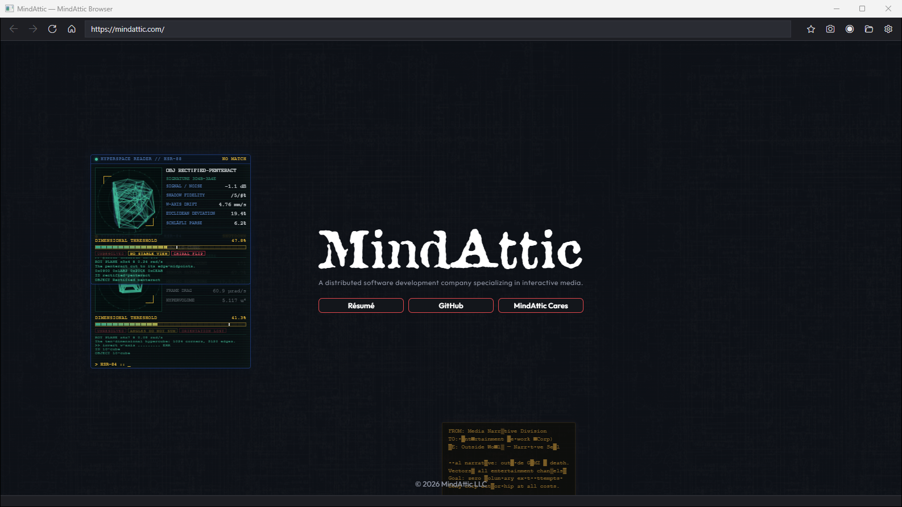
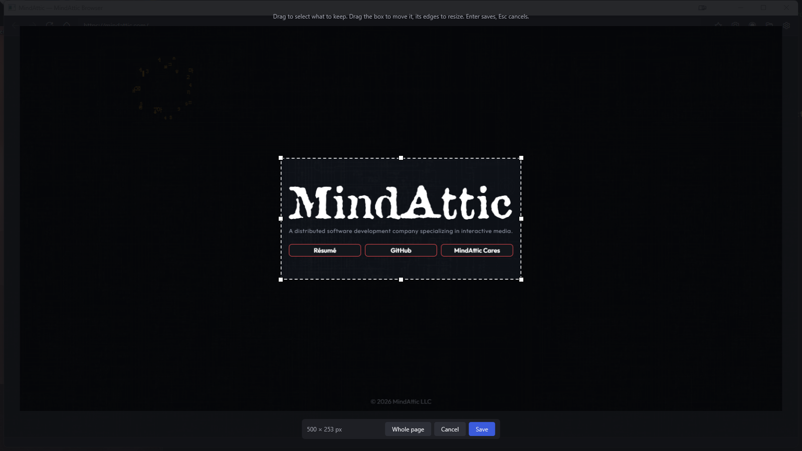

# MindAttic.Browser

A Windows browser for everyday browsing that turns anything on screen into a screenshot or a video on your clipboard in one click, and serves a local site folder as if it were deployed.

[](src/MindAttic.Browser/MindAttic.Browser.csproj) [](https://developer.microsoft.com/microsoft-edge/webview2/) [](tests/MindAttic.Browser.Tests) [](#)



## Why

- You see something worth keeping while browsing: one click (or Ctrl+Shift+S) shoots it, lets you crop it, saves it and puts it on the clipboard, ready to paste.
- Recording is the same: press record, press it again, and the finished video's file is on the clipboard.
- Every file is named after the site it shows (`youtube.com_2026-10-11T20.45.28.638.png`), so a folder of captures explains itself.
- A local static site opens at `https://<site>.local/` and behaves like the deployed page, with no web server.

## Features

| Button | Shortcut | What it does |
|---|---|---|
| ← → ⟳ ⌂ | Alt+Left, Alt+Right, F5 | Back, forward, reload, home page |
| ☆ | Ctrl+D | Star or unstar this page; the menu lists your favorites |
| 📷 | Ctrl+Shift+S | Screenshot the page, crop it in the lightbox, save it and copy it |
| ● / ■ | Ctrl+Shift+R | Start recording; stop, write the video and copy its file |
| 📁 | | Open this site's capture folder |
| ⚙ | Ctrl+, | Settings: home page, search engine, capture folder, clipboard and crop options |

Ctrl+L focuses the address bar and F12 opens DevTools. Text that isn't a URL is searched with the engine set in Settings.

### The crop lightbox



A screenshot opens over the browser with the whole page selected. Drag to select what to keep, drag the box to move it, drag a handle to resize it. Enter saves, Esc cancels, Ctrl+A selects the whole page again. Turn the lightbox off in Settings to save the whole page immediately.

## Quick start

Prerequisites: Windows 10 2004 or later, the .NET 10 SDK, the WebView2 runtime (part of Windows 11), and the MindAttic.Capture packages in `C:\LocalNuGet`:

```powershell
cd ..\MindAttic.Capture
dotnet pack -c Release -o C:\LocalNuGet
.\tools\install.ps1                      # optional: the capture agent, so recordings export after the browser closes
cd ..\MindAttic.Browser
.\run.ps1 -Launch https://example.com
```

`run.ps1` republishes to `C:\Apps\MindAttic.Browser\` only when something changed: a source file newer than the deployed exe, a newer `MindAttic.Capture*.nupkg` in `C:\LocalNuGet`, or a missing exe. Otherwise it is a fast no-op. `run.ps1 -Force` always does a clean bin/obj rebuild. Before publishing, it asks a deployed instance that's still open (it might be mid-recording) to close and waits up to 30s; if it's still there, it keeps that build instead of killing it. Every run also writes `C:\Apps\MindAttic.Browser\run.bat`, the desktop shortcut target (`run.ps1 -LauncherOnly` writes just that). A double-click opens a menu: **1) Deploy & Run** (runs `run.ps1 -Force`, then starts the exe) or **2) Run** (starts the deployed exe as is). The launcher forwards its arguments to the exe, so `run.bat <url> -capture video` works exactly like calling the exe itself.

You should see the page with the toolbar above it. Press Ctrl+Shift+S, then Enter: the status bar says where the screenshot was saved and that it is on the clipboard.

## Usage

```powershell
MindAttic.Browser.exe                                   # your home page
MindAttic.Browser.exe youtube.com                       # any URL or search text
MindAttic.Browser.exe D:\Projects\MindAttic\MindAttic.Web\mindattic.com   # serve a site folder at https://mindattic.com.local/
MindAttic.Browser.exe page.html --host demo.local       # serve a file's folder under a chosen host name
MindAttic.Browser.exe https://mindattic.com -capture video 8h   # film the whole visit (MindAttic.Capture flags)
MindAttic.Browser.exe mindattic.com -capture screen 5   # a PNG every 5 seconds
```

The `-capture` flags come from [MindAttic.Capture](https://github.com/mindattic/MindAttic.Capture): `video` records the whole session, `screen N` takes a screenshot every N seconds, `hq` uses a hardware HEVC tape, and a duration caps the run. Disk, memory and encoder limits stop long runs automatically.

## Where things go

| What | Where |
|---|---|
| Screenshots | `<capture folder>\<site>\<site>_<timestamp>.png`, named after the page shown |
| Recordings | `<capture folder>\<subject>\<subject>_<timestamp>.mp4` (plus a lossless `.mkv`), named after the site the browser opened |
| Settings and favorites | `%APPDATA%\MindAttic\MindAttic.Browser\settings.json`, through [MindAttic.Vault](https://github.com/mindattic/MindAttic.Vault) |
| Browser profile (cookies, cache) | `%LOCALAPPDATA%\MindAttic\Browser` |

The capture folder defaults to `R:\MindAttic\Capture`, or `Pictures\MindAttic Browser` on a machine without that drive. Recordings pick up a new folder at the next launch. Unstarring a favorite marks it removed instead of deleting it, so starring the page again restores it.

## Limits

- Recordings capture the whole browser window, toolbar included; screenshots capture only the page.
- Video can't sit on the clipboard as data, so a recording is copied as a file: paste it into a folder, chat or uploader.
- When a site folder is served, only that site can use the page capture bridge (`window.mindattic.capture`), and other websites can't read the folder.

## Project layout

```text
MindAttic.Browser/
  src/MindAttic.Browser/        the WPF app: MainWindow, CropWindow, SettingsWindow, settings, favorites, naming
  tests/MindAttic.Browser.Tests NUnit: targets, search, favorites, settings round-trip, file names, crop geometry
  run.ps1                       publish to C:\Apps\MindAttic.Browser\ when source changed, write its run.bat launcher
  docs/images/                  README screenshots
```

## Testing

```powershell
dotnet test
```

The suite covers command-line targets and address-bar search, favorites (including soft removal), the Vault settings round-trip keeping unknown keys, capture file naming, and the crop lightbox geometry.

## License

This repo has no LICENSE file. All rights reserved.

Part of [MindAttic](https://mindattic.com): see more projects at [github.com/mindattic](https://github.com/mindattic). Related: [MindAttic.Capture](https://github.com/mindattic/MindAttic.Capture), [MindAttic.Vault](https://github.com/mindattic/MindAttic.Vault), [MindAttic.Web](https://github.com/mindattic/MindAttic.Web).
